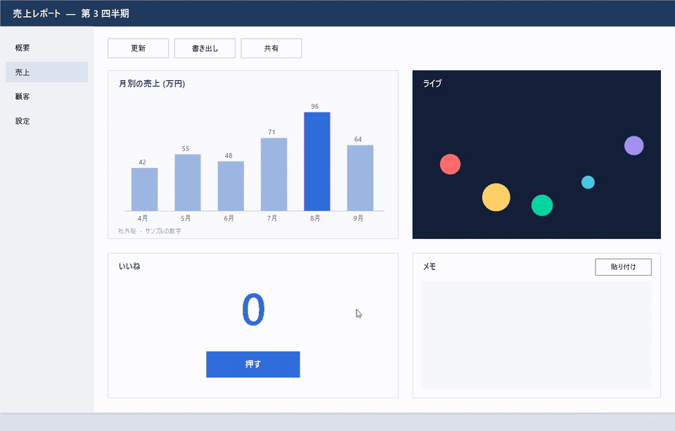

# Manent

**撮った画面が、その場に残る。ピン留めキャプチャツール**

Manent は、撮った画面をファイルにせず、撮った位置にそのまま貼り付けておくキャプチャツールです。資料を見比べたり、手順を横に置いておいたり、動きを GIF で見せたりするときも、保存先を探す手間なく、画面の上で済ませられます。

名前はラテン語の格言 *Verba volant, scripta manent*（言葉は飛び去り、書かれたものは残る）から取りました。

## コンセプト

### 📌 撮った位置にピン留め

撮った画像は、撮った場所に等倍で残ります。ドラッグで動かし、ホイールで拡大・縮小し、不透明度を下げて下の画面と重ねられます。クリックを下の窓へ通せば、ピンを表示したまま裏のアプリを操作できます。ファイルには、必要なときだけ手動で保存します。

### 🎞️ GIF もピンになる

範囲を録画すると、止めた位置にそのまま GIF のピンが出ます。フィルムストリップで前後を切り詰め、要らないフレームを消してから、<kbd>Ctrl</kbd>+<kbd>C</kbd> で GIF ファイルとしてコピーできます。

### ✏️ その場で書き込める

矢印・直線・矩形・楕円・テキスト・番号バッジ・ペン・蛍光ペン・モザイクの 9 種類で書き込めます。書き込みは選択ツールで選んで動かせます。ドラッグで囲めば、複数をまとめて動かせます。元に戻すこともできます。GIF では、書き込みごとに出すフレームの区間を決められます。

### 🎯 狙った所を一発で選ぶ

<kbd>Ctrl</kbd> を押すと、カーソルの下のウインドウやボタンなどの部品が光ります。そのままクリックすれば、その範囲を撮れます。ドラッグで範囲を作るときも、<kbd>Ctrl</kbd> を押していれば辺が部品の端に吸い付きます。静止画のキーを押した時点で画面を止めるので、メニューやツールチップのように消えやすいものも撮れます。

## 主な機能

- 呼び出し方：ホットキー、トレイのアイコンのクリック、<kbd>Win</kbd>+<kbd>Shift</kbd>+<kbd>S</kbd>（Windows の「既定のアプリ」で Manent を選んだとき）
- 画像ファイルをピン：エクスプローラで画像を右クリックして「Manent でピン留め」
- 書き出し：コピー（静止画・GIF・GIF の今のフレーム）、PNG / GIF で保存。GIF は縮小の倍率（100〜25%）を選べる
- GIF のサイズ上限：上限（25 / 10 / 5 / 3 / 1 MB）を選ぶと、収まるまで縮めて書き出す
- モニタごとに拡大率が違う環境でも等倍で表示。日本語 / English UI、ライト / ダークのテーマに追従

## 動作環境

- Windows 11（x64）

## インストール

[Releases](https://github.com/koorinonaka/manent/releases/latest) から次のどちらかをダウンロードしてください。管理者権限は要りません。

- `Manent-Setup-<version>.exe`：インストーラ。サインイン時の起動と、設定の「更新」ボタンからの更新に対応します
- `Manent-<version>-portable.zip`：展開してすぐ使える単体の exe

GitHub 版 (上の 2 つ) と Microsoft Store 版は、どちらか片方だけを使ってください。両方を入れると、自動起動や右クリックのメニューが二重になります。

> [!NOTE]
> 実行ファイルにコード署名をしていないため、初回の起動時に「Windows によって PC が保護されました」と表示されることがあります。「詳細情報」→「実行」で起動できます。

## 使い方

1. <kbd>PrintScreen</kbd> を押すと、画面が止まって範囲を選べます
2. ドラッグするか、<kbd>Ctrl</kbd> を押して部品をクリックすると、その位置にピンが出ます
3. ピンにカーソルを載せるとツールバーが出ます。コピー・保存・書き込みはここから行います。<kbd>Esc</kbd> でピンを閉じます

動画は <kbd>Shift</kbd>+<kbd>PrintScreen</kbd> で範囲を選びます。カウントダウン（既定 3 秒）の後に録画が始まり、同じキーか停止ボタンで止めると GIF のピンが出ます。

> [!TIP]
> Manent はトレイに常駐します。トレイのアイコンを右クリックすると、開いているピンの一覧、設定、終了のメニューが出ます。

## 設定

| 設定 | 内容 |
| --- | --- |
| ホットキー | 静止画キャプチャ（既定 <kbd>PrintScreen</kbd>）、動画キャプチャ（既定 <kbd>Shift</kbd>+<kbd>PrintScreen</kbd>） |
| PrintScreen キーで撮る | オンにすると、PrintScreen で静止画、<kbd>Shift</kbd>+PrintScreen で動画を撮ります。キーを Manent が受け取るため、ゲームなど前面のアプリには届かなくなります（既定はオン） |
| サインイン時に起動 | 既定はオン |
| エクスプローラの右クリックメニューに出す | 画像の右クリックに「Manent でピン留め」を出します（既定はオン） |
| カーソルを写す | 静止画（既定はオフ）と動画（既定はオン）で別々に選べます |
| フレームレート | 10 / 15 / 20 / 30 / 60 fps（既定 30） |
| 録画の上限 | 10 秒〜5 分（既定 60 秒） |
| 録画前のカウントダウン | オフ / 1 / 2 / 3 / 5 / 10 秒（既定 3 秒） |
| ピンをキャプチャに写す | オンにすると、ピンとそのツールバー、トレイのメニューが、画面のキャプチャと録画に写ります（既定はオフ） |
| 保存先フォルダ | 手動で保存するときに最初に開くフォルダ |
| 更新の確認 | 起動時と 24 時間ごとに GitHub で新しい版を確かめ、見つけたら通知します（既定はオン） |
| 言語 | 自動 / 日本語 / English |

> [!NOTE]
> 更新の確認でだけ `api.github.com` に接続します。「更新」ボタンを押したときは、インストーラを `github.com` からダウンロードします。設定でオフにすると、Manent は外部と一切通信しません。

## 開発

ビルド方法とインストーラの作り方は [docs/development.md](docs/development.md) を参照してください。

## ライセンス

[MIT](LICENSE)
